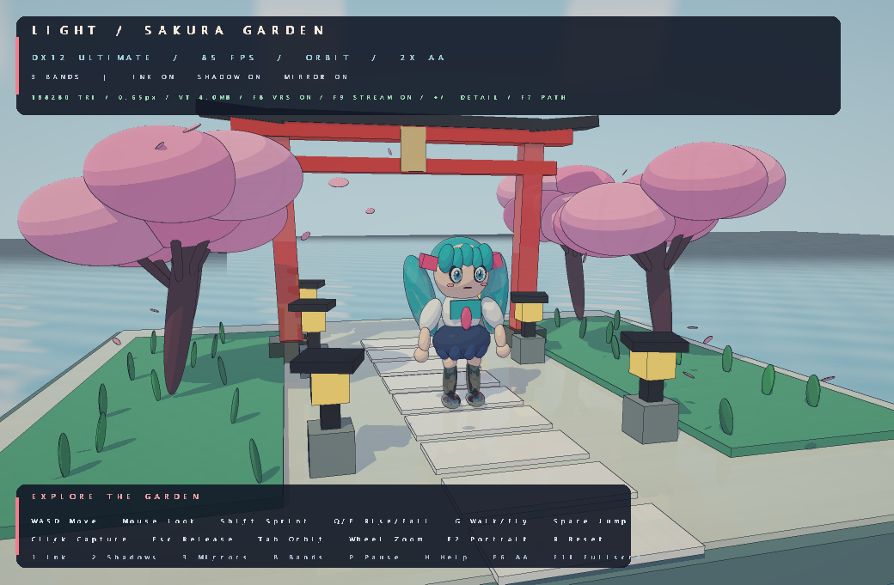
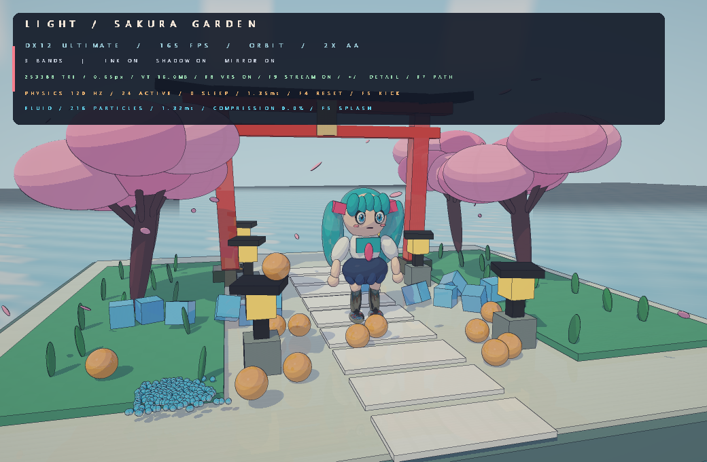
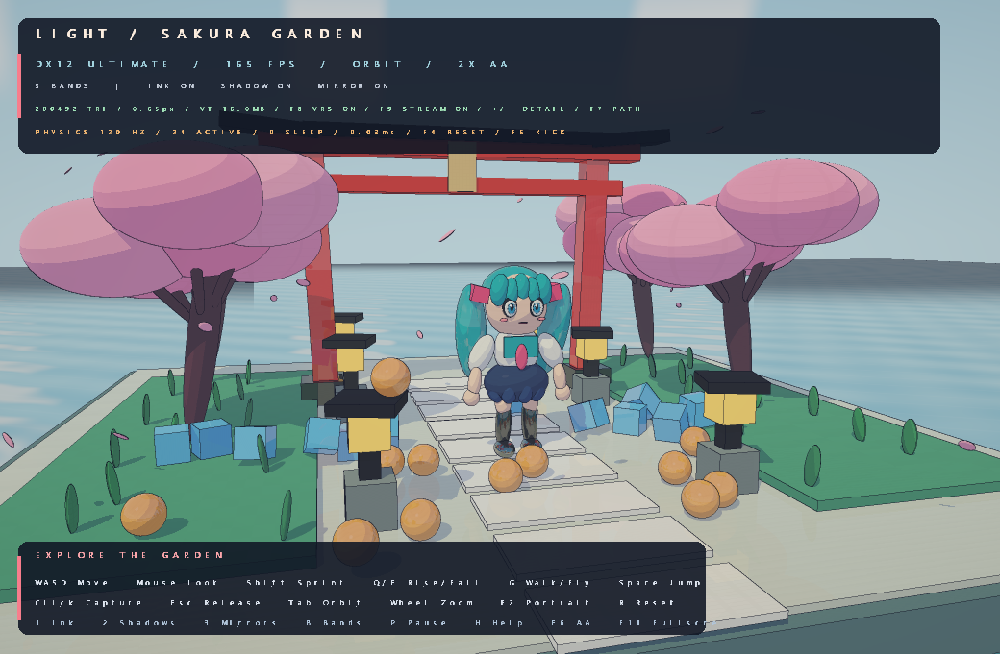

# LightRenderer · Sakura Garden

## 프로젝트 목적

**AI를 활용해 DX12(DirectX 12) 기반 실시간 렌더러를 밑바닥부터 만드는 것**이 이 프로젝트의 목적입니다. Rust와 HLSL로 그래픽스 파이프라인, 셰이딩, GPU 메모리 관리와 물리 시뮬레이션을 직접 구현하고, AI와 함께 기능을 확장하며 실제 실행 결과로 검증하는 과정을 기록합니다.

## 현재 구현

Rust + **windows-rs**로 직접 구현한 Windows용 **DirectX 12 Ultimate 셀 셰이딩 렌더러**입니다. Mesh Shader, DXR, VRS Tier 2, Sampler Feedback을 실제 사용하며, 벚꽃 정원과 오리지널 캐릭터를 게임처럼 탐색할 수 있습니다.



## 실행

```powershell
.\scripts\run.ps1
```

실행 스크립트는 프로젝트 내부 `.sdk`에 **Agility SDK 1.619.6 / DXC 1.9.2609.5**를 준비합니다. NuGet 버전과 SHA-256을 고정하고 검증하며 시스템 SDK를 교체하지 않습니다. HLSL은 빌드 때 EXE에 포함됩니다. EXE 직접 배포 시 옆의 `D3D12` 런타임 폴더도 함께 배치하세요.

```powershell
.\target\release\light-renderer.exe
```

필요 환경: Windows 10 2004 이상 또는 Windows 11, 최신 GPU 드라이버, Rust MSVC 도구 체인과 Visual Studio C++ Build Tools. 수동 빌드 전에 `.\scripts\bootstrap-sdk.ps1`을 실행하세요. 기능을 조회해 Ultimate / DXR 1.1 / SM 6.0 컴퓨트 레이 트레이싱을 자동 선택합니다.

## DX12 Ultimate와 동적 디테일

| 기능 | 실제 구현 |
| --- | --- |
| Mesh Shader Tier 1 | 화면 오차 목표와 거리로 분할 밀도를 계산하고 `DispatchMesh`로 표면 생성. 패치당 최대 64정점 / 98삼각형 |
| DXR Tier 1.1 이상 | 매 프레임 BLAS/TLAS를 갱신하고 inline `RayQuery`로 그림자·반사 추적. 전체 광선 카메라 경로도 유지 |
| VRS Tier 2 | 중앙 1×1, 주변 1×2 및 2×2 shading rate image를 `RSSetShadingRateImage`로 적용 |
| Sampler Feedback | `WriteSamplerFeedbackLevel` → 하드웨어 decode → GPU 리드백 → 필요한 텍스처 페이지 요청 |
| Tiled Resources | 16,384² RGBA8 reserved texture. 64KB 타일을 `UpdateTileMappings` / `CopyTiles`로 매핑·업로드·회수 |

**미리 만든 고정 LOD 메시를 전환하지 않습니다.** 현재 타원체·상자를 파라메트릭 표면으로 표현하고 화면 크기에 따라 필요한 폴리곤을 GPU에서 생성합니다. `+` / `-`로 화면 오차 목표를 연속 조절합니다. 분할 밀도는 축별 6–96 범위로 제한합니다. 이는 현재 절차적 장면의 동적 지오메트리 구현이며, 임의의 대형 모델을 디스크에서 읽는 클러스터 스트리밍/모델 임포터는 포함하지 않습니다.

텍스처 가상 주소 공간은 mip 포함 약 **1.33GiB**, 물리 타일 풀은 **기본 16MiB**입니다. `--texture-budget-mb 4..256`으로 상주 한도를 지정합니다. 저해상도 mip와 packed tail은 항상 상주하고, 나머지는 GPU 피드백으로 요청합니다. 별도 작업 스레드가 페이지를 생성하거나 `assets/vt-cache`에서 읽습니다. 가시 범위와 기존 상주 상태로 요청을 제한하고 LRU 회수로 예산을 지킵니다. 상주 비트 마스크로 실제 매핑된 정확한 mip만 샘플링합니다. 텍스처 mip는 샘플링·스트리밍을 위해 유지합니다.

메모리 예산은 텍스처 타일 풀의 한도이며 렌더 타깃·가속 구조 등의 전체 GPU 메모리 한도는 아닙니다. 패치 메타데이터는 매 프레임 업로드하고 정점/인덱스 버퍼를 미리 상주시킬 필요가 없습니다. 피드백 읽기는 이전 프레임의 GPU 완료 이후 수행하고, 페이지 생성 및 디스크 I/O는 작업 스레드에서 실행합니다.

```powershell
.\target\release\light-renderer.exe --renderer ultimate --texture-budget-mb 16 --detail-error 0.65
.\target\release\light-renderer.exe --renderer ultimate --no-vrs --no-streaming
.\target\release\light-renderer.exe --renderer raytracing
```

`--renderer ultimate`는 필요한 기능 부족 시 명확히 실패합니다. 기본 `auto`는 기능 조회 후 폴백합니다. 구현 파일은 `src/detail.rs`, `src/ultimate.rs`, `src/streaming.rs`, `src/capabilities.rs`, `src/agility.rs`, `shaders/ultimate.hlsl`입니다.

### Shader Model / OMM / SER

지원 GPU에서는 **SM 6.9**, 그 외 Ultimate 지원 장치에서는 6.5 Mesh/Pixel Shader를 선택합니다. 안정 버전 SDK를 고정하며 6.10 preview를 사용하지 않습니다. RTX 4080의 실제 조회에서 DXR 1.2, SM 6.9, OMM 및 SER 실제 재정렬 지원을 확인했습니다.

**OMM·SER 실행 경로는 구현하지 않았습니다.** 현재 DXR은 procedural AABB 기반이며 OMM은 삼각형 지오메트리, SER은 ray-generation 셰이더 경로가 별도로 필요합니다. 사용자 요청에 따라 Ultimate와 스트리밍을 우선 구현했습니다. JSON의 `omm_ser_integrated: false`로 지원 조회와 실행 적용을 구분합니다.

공식 자료: [Mesh Shader](https://microsoft.github.io/DirectX-Specs/d3d/MeshShader.html), [Sampler Feedback](https://github.com/microsoft/DirectX-Specs/blob/master/d3d/SamplerFeedback.md), [SM 6.9 안정 버전](https://devblogs.microsoft.com/directx/shader-model-6-9-retail-and-more/).

## 조작

| 입력 | 동작 |
| --- | --- |
| WASD | 이동, 궤도 카메라에서 자유 카메라로 전환 |
| 화면 클릭 / Esc | 마우스 시점 조작 시작 / 커서 해제 |
| 마우스 | 시점 회전, 궤도 모드에서는 캐릭터 주변 회전 |
| Shift | 빠르게 이동 |
| Q / E | 비행 모드에서 하강 / 상승 |
| G | 걷기 / 비행, 걷기 모드에는 정원 경계 및 주요 소품 충돌 적용 |
| Space | 걷기 모드에서 점프 |
| Tab / 휠 | 궤도 모드 전환 / 궤도 거리 변경 |
| F2 / F3 / R | 캐릭터 클로즈업 / 정원 카메라 / 초기화 |
| F4 / F5 | 물리 데모 초기화 / 공과 상자에 충격 가하기 |
| 1 / 2 / 3 | 윤곽선 / 레이 트레이싱 그림자 / 반사 전환 |
| B | 셀 명암 단계 변경: 2–5단계 |
| F6 | 1× / 2× 슈퍼샘플링 전환; 2×는 픽셀당 4개 샘플 |
| F7 | Ultimate Mesh Shader / 전체 광선 추적 카메라 경로 |
| F8 / F9 | VRS / 텍스처 페이지 스트리밍 전환. 스트리밍을 끄면 현재 페이지 유지 |
| + / - | 폴리곤 디테일 증가 / 감소: 화면 오차 목표 조절 |
| P / H | 애니메이션·물리 일시정지 / 도움말 표시 |
| F11 / F12 | 테두리 없는 전체 화면 / `artifacts/screenshot.bmp` 저장 |
| Alt+F4 | 종료 |

DXR 모드는 기본 2× 슈퍼샘플링, 소프트웨어 모드는 기본 1×입니다. 프레임률과 렌더링 모드가 HUD 및 창 제목에 표시됩니다.

## 렌더링 구조

- `src/renderer.rs`: DXGI 고성능 GPU 선택, D3D12 장치·큐·펜스, flip-discard 스왑 체인, 루트 시그니처, 컴퓨트 파이프라인, GPU 리드백 및 디버그 메시지 수집.
- `src/scene.rs`: 206개 회전된 타원체와 상자. 머리카락, 팔, 꽃잎, 풀이 시간에 따라 움직입니다. 외부 모델이나 텍스처 없이 재현 가능한 데모 장면입니다.
- `shaders/garden.hlsl`: DXR `RayQuery`가 BLAS/TLAS의 절차적 AABB를 탐색하고 후보 타원체·상자의 교차를 `CommitProceduralPrimitiveHit`로 확정합니다. Ultimate 모드는 카메라 가시 표면을 Mesh Shader로 생성하고 그림자·반사에 DXR을 사용합니다. 전체 광선 모드는 카메라 광선도 DXR을 사용합니다.
- DXR 가속 구조는 변경된 경계로 매 프레임 다시 구축합니다. 폴백은 동일한 교차 함수와 재질을 사용하는 D3D12 컴퓨트 셰이더입니다.
- HDR beauty 및 normal/depth 버퍼 이후 명암 양자화, 깊이·법선 윤곽선, 슈퍼샘플링 리졸브, 감마 및 HUD 합성을 수행합니다. HUD 글꼴은 Segoe UI를 GDI로 래스터화한 GPU 아틀라스입니다.
- `src/camera.rs`: 독립적인 궤도 / 비행 / 걷기 카메라, 정규화된 이동, 충돌 및 점프.

이 구현은 확장 가능한 실시간 데모 렌더러입니다. 캐릭터는 절차적 도형으로 구성되며, 모델 임포터·스켈레탈 애니메이션·다중 바운스 글로벌 일루미네이션은 포함하지 않습니다. 동기화 안정성을 위해 프레임별 펜스를 기다리는 구조이며, 향후 프레임 리소스 링과 AS refit으로 확장할 수 있습니다.

## 검사와 재현

### 직접 구현한 실시간 물리

**외부 물리·벤치마크 패키지를 추가하지 않았습니다.** 기존 수학 의존성 `glam`의 `Vec3A`, `Mat3A`를 사용하고 충돌·적분·솔버는 `src/physics.rs`에서 직접 구현합니다. 기본 x86_64 빌드는 SSE2 벡터 연산을 사용합니다. `physics-scalar` 기능은 같은 코드에 `glam/scalar-math`를 적용해 비교합니다. AVX 전용 실행 파일이나 nightly Rust가 필요하지 않습니다.

- 구·회전 상자(OBB), 정적/동적 강체, 질량·관성·선속도·각속도, 중력, 반발, Coulomb 마찰.
- AABB sweep-and-prune broad phase: 몸체 중심의 분포가 가장 넓은 축으로 정렬. 정확한 구–구, 구–OBB 검사 및 OBB–OBB의 15축 SAT. 면 접촉은 다각형 클리핑으로 최대 8개 점, 모서리는 가장 가까운 선분 점으로 생성합니다.
- 누적 충격량을 적용하는 sequential impulse 솔버(기본 10회). 관성 텐서, 접촉 Jacobian, 2×2 접선 유효 질량을 미리 계산해 반복 계산을 줄입니다. 침투 보정, 수면 및 충격에 의한 깨우기를 포함합니다.
- 기본 120Hz 고정 tick, 위치·회전 보간. 프레임당 최대 8tick으로 작업량을 제한하며 버린 시간을 통계에 기록합니다. 일시정지 동안 물리와 보간 상태를 유지합니다.
- 빠른 물체는 이동량·회전량에 따라 최대 16개의 motion substep을 사용합니다. **완전한 swept-shape CCD는 아닙니다.** 한도를 초과하면 `motion_limit_hits`를 기록하며, 극단적인 속도에서는 관통할 수 있습니다.

정원에 주황색 구 12개와 파란 상자 12개를 추가했습니다. 정원 상자는 렌더링과 같은 크기·회전으로 충돌하고, 나무 줄기·캐릭터에는 단순 상자 충돌 프록시를 사용합니다. 같은 보간된 물리 위치를 Ultimate Mesh Shader, DXR, 컴퓨트 폴백에 넘깁니다. `src/physics_demo.rs`가 핸들과 고정 렌더 슬롯을 연결하며 `--no-physics`는 기존 206개 도형 장면을 유지합니다. HUD에 활성/수면 몸체 수와 물리 tick의 CPU 시간을 표시합니다. 걷기 카메라는 기존 컨트롤러를 계속 사용하며 동적 물체와 상호작용하지 않습니다.

```powershell
.\scripts\run.ps1
.\target\release\light-renderer.exe --no-physics
.\scripts\physics-smoke.ps1
.\scripts\physics-bench.ps1 -CompareScalar
# 현재 머신에 맞춘 선택적 p95 성능 게이트
.\scripts\physics-bench.ps1 -CompareScalar -MaxP95Ms 8.333333
```

라이브러리 API는 GPU 없이 `World::new`, `insert`, `body`, `bodies`, `apply_impulse`, `advance` 또는 `step`으로 사용할 수 있습니다. 단위는 m/kg/s이며 `BodyDesc::fixed`는 질량 0, `dynamic`은 양의 질량을 사용합니다. 입력 검증 실패는 `PhysicsError`를 반환합니다. 핸들은 월드 내부의 추가 전용 인덱스입니다. 리셋 후에는 새 핸들을 사용해야 합니다.

```rust
use glam::Vec3A;
use light_renderer::physics::{BodyDesc, Config, PhysicsError, Shape, World};

fn main() -> Result<(), PhysicsError> {
    let mut world = World::new(Config::default())?;
    let ball = world.insert(BodyDesc::dynamic(
        Shape::Sphere { radius: 0.25 }, Vec3A::new(0., 3., 0.), 1.,
    ))?;
    world.advance(1. / 60., false)?;
    let pose = world.body(ball).unwrap().interpolated_pose(world.interpolation_alpha());
    println!("{:?}", pose.position);
    Ok(())
}
```

삼각형 메시 충돌, 관절, 천, 지속 접촉 warm start, 강체 삭제, 멀티스레드, 네트워크용 플랫폼 간 결정론은 포함하지 않습니다. 단일 축 sweep은 모든 AABB가 겹치는 배치에서 O(n²)이며, 강체 motion substep은 강체 전체에 적용됩니다. 빌드는 기존 프로젝트의 Windows/DXC 환경을 사용하며 벤치마크 실행에는 GPU나 창이 필요하지 않습니다. 유체는 아래의 별도 입자 솔버가 담당합니다.

### 유체역학: Position Based Fluids

`src/physics/fluid.rs`에 **외부 의존성 없이 3차원 PBF 유체 솔버를 구현**했습니다. [Macklin·Müller의 Position Based Fluids 논문](https://matthias-research.github.io/pages/publications/pbf_sig_preprint.pdf)의 SPH 밀도와 밀도 제약을 바탕으로, 자유 표면의 부족한 밀도는 허용하고 과도한 압축만 보정합니다. 압력 효과는 밀도 제약으로 표현하며 공학용 압력장의 정확도 검증은 수행하지 않았습니다.

- Poly6 밀도 커널(자기 입자 포함), Spiky 밀도 제약 기울기, Jacobi 위치 보정, 기본 4회 밀도 반복. 위치 수정 후 이웃을 다시 검색해 새 접촉을 빠뜨리지 않습니다. 압축 제약이 모두 0이면 남은 반복을 생략합니다.
- 셀 크기가 커널 반경인 균일 격자에서 27개 주변 셀을 검색합니다. 셀의 입자 순서를 고정하고 각 쌍을 한 번만 처리하며, 작업 버퍼의 용량을 재사용합니다. 모든 입자가 한 셀에 몰리면 쌍 처리는 O(n²)입니다.
- 대칭 XSPH 점성 확산: 쌍마다 반대 방향으로 속도를 수정하고 확산량을 제한합니다. 점성 단독 테스트로 선운동량 보존과 운동에너지 감소를 확인했습니다. 점성 값은 완화율(s⁻¹)이며 측정된 물의 동점성 계수는 아닙니다.
- 고정 질량 입자, 중력, 용기 6면의 입자 반경 보정·반발·마찰, 구·OBB 강체 경계, 이동/회전 경계 속도. 기본 2substep이며 이동량에 따라 최대 16회로 증가합니다. 보정량·속도·substep 한도 도달을 각각 기록합니다.
- 입자 위치 보간. `World`에 등록하면 월드의 시간 간격·중력·일시정지·catchup 정책을 공유합니다. 단독 `Fluid::step(dt)` 실행 시에는 유체 설정의 중력을 사용합니다.

**강체 경계는 단방향**입니다. 움직이는 강체는 입자를 밀어내지만 유체가 강체에 압력·부력을 되돌려 주지는 않습니다. OBB는 입자 반경만큼 확장한 보수적 경계이며, 용기와 강체가 충돌하면 용기 경계를 우선합니다. 벽의 유령 입자/밀도 보정, 표면 장력·와도 보강, 다상 유체, 유체 표면 메시, 양방향 강체 연성은 포함하지 않습니다. 입자 재배치로 질량을 잃지 않지만, 경계·속도 제한·밀도 근사 때문에 물리량의 완전한 보존이나 CFD 정확성을 보장하지 않습니다.

```powershell
.\scripts\run.ps1 -Fluid
.\target\release\light-renderer.exe --fluid
cargo test --locked --lib physics::fluid
.\scripts\fluid-smoke.ps1
.\scripts\fluid-bench.ps1 -CompareScalar
```

`--fluid`는 기존 강체 데모에 파란 유체 입자 **216개**를 더합니다(전체 446개 도형). **F4**는 유체·강체를 함께 초기화하고, **F5**는 물을 튀기며, **P**는 함께 일시정지합니다. 입자 자체를 렌더링하며 매끈한 물 표면을 재구성하지 않습니다. HUD에 입자 수, CPU 시간, 압축률을 표시합니다. 기본 실행에는 유체를 켜지 않으며 `--fluid --no-physics`는 잘못된 조합으로 거부됩니다.

```rust
use glam::Vec3A;
use light_renderer::physics::{Config, PhysicsError, World};
use light_renderer::physics::fluid::{Fluid, FluidConfig, ParticleDesc};

fn main() -> Result<(), PhysicsError> {
    let mut world = World::new(Config::default())?;
    let mut fluid = Fluid::new(FluidConfig::default())?;
    fluid.insert(ParticleDesc::new(Vec3A::new(0., 1., 0.)))?;
    let id = world.add_fluid(fluid);
    world.advance(1. / 60., false)?;
    let p = world.fluid(id).unwrap().particles()[0]
        .interpolated_position(world.interpolation_alpha());
    println!("{:?}", p);
    Ok(())
}
```

유체 전용 검사 18개(솔버 17개 + 데모 통합 1개)를 추가했습니다. 커널 정규화·지지 영역, 이웃 검색과 전수 검사의 일치, 격자 밀도, 압축 감소, 위치/선운동량 보존, 점성의 에너지 감소, 중력·이류, 경계 반발·충돌 전 속도 기준 반발 계수, 댐 붕괴의 질량 보존·퍼짐, 겹친 입자, 잘못된 입력, 고정 시간 재생·일시정지·보간, 이동하는 구·OBB 경계, 한도 도달, 리셋·물 튀기기를 검사합니다. 기존 검사를 포함한 총 40개가 SIMD와 스칼라 빌드에서 통과했습니다.

`benches/fluid.rs`는 희소 입자, 216/512/1,024입자 댐 붕괴, 512입자 점성 흐름의 5케이스를 실행합니다. 평균·p50·p95·p99·최대 CPU 시간과 실제 이웃 쌍·후보 수·substep·압축 잔차·한도 도달을 기록하고, 각 실행 후 질량·입자 수·유한 상태·용기 경계를 검사합니다. 워밍업 30tick을 제외하고 120tick × 3회 측정했습니다(AMD Ryzen 7 7800X3D, Rust 1.99.0, release, 120Hz, 최대 4회 밀도 반복). 강체 충돌과 GPU 렌더링은 벤치마크 시간에서 제외됩니다.

| 유체 케이스 | 입자 수 | SIMD 평균 ms | SIMD p95 ms | 스칼라 평균 ms |
| --- | ---: | ---: | ---: | ---: |
| 희소 | 512 | 0.273 | 0.372 | 0.270 |
| 댐 붕괴 | 216 | 0.369 | 1.102 | 0.339 |
| 댐 붕괴 | 512 | 2.182 | 3.098 | 2.170 |
| 댐 붕괴 | 1,024 | 6.298 | 9.861 | 6.336 |
| 점성 흐름 | 512 | 2.219 | 3.058 | 2.250 |

1,024입자 댐 붕괴는 p95가 120Hz의 **8.33ms 예산을 초과**합니다. 해당 케이스의 최대 압축 잔차도 약 9.4%로 남습니다. 입자 수·분포·substep에 따라 비용과 오차가 변하며 SIMD의 이득도 작을 수 있습니다. `-MaxP95Ms`는 지정한 경우에만 머신별 성능 게이트를 적용합니다. 원본 통계는 `artifacts/fluid-bench-simd.json`, `fluid-bench-scalar.json`, `fluid-bench-comparison.json`입니다.

`fluid-smoke.ps1`로 Ultimate/DXR/컴퓨트에서 각각 180프레임·350tick을 완료했습니다. 216입자와 총 질량 약 110.592kg, 용기 경계를 유지하며 일시정지·물 튀기기를 확인했고 GPU 경고·오류 및 속도/substep 한도 도달은 0건이었습니다. 유체를 끈 기존 강체 스모크 네 경로도 통과했습니다. 결과는 `artifacts/fluid-validation.json`, `fluid-*-report.json`과 실제 GPU 캡처에 있습니다.



### 물리 성능 측정과 검증 결과

`benches/physics.rs`는 별도 패키지 없이 `cargo bench --locked --bench physics`로 실행됩니다. 8가지 워크로드에서 평균·p50·p95·p99·최대 시간, 실제 활성 몸체·접촉·후보쌍·substep 수를 JSON으로 기록합니다. dense는 수면을 꺼서 모든 몸체를 계산하고, sleeping은 실제 512개가 수면에 진입했는지 검사합니다. motion은 빠른 비접촉 구의 substep 비용을 측정하며 고속 충돌 정확성은 별도 테스트로 검사합니다.

2026-10-10, AMD Ryzen 7 7800X3D, Rust 1.99.0, release(thin LTO), 120Hz/10회 솔버에서 측정했습니다. 각 워크로드는 워밍업 후 180tick × 3회(540개 표본), 두 빌드는 순차 실행했습니다. **CPU 물리 비용만 포함하며 렌더링/GPU/초기 월드 생성/워밍업은 제외합니다.** 아래 값은 이 머신의 실측치이고 다른 CPU나 모든 배치의 성능을 보장하지 않습니다.

| 워크로드 | 몸체 수 | SIMD 평균 ms | SIMD p95 ms | 스칼라 평균 ms |
| --- | ---: | ---: | ---: | ---: |
| 희소, 모두 활성 | 256 | 0.008 | 0.007 | 0.009 |
| 희소, 모두 활성 | 1,024 | 0.045 | 0.053 | 0.052 |
| 희소, 모두 활성 | 4,096 | 0.445 | 0.636 | 0.499 |
| 적층 충돌, 모두 활성 | 128 | 0.215 | 0.249 | 0.296 |
| 적층 충돌, 모두 활성 | 512 | 0.880 | 1.035 | 1.170 |
| 적층 충돌, 모두 활성 | 2,048 | 3.699 | 4.072 | 5.001 |
| 수면 | 512 | 0.013 | 0.013 | 0.012 |
| 고속 motion substep | 128 | 0.044 | 0.055 | 0.051 |

적층 2,048개에서 SIMD 빌드는 평균 시간이 스칼라보다 약 26% 짧았습니다. 부동소수점 반올림으로 접촉 궤적·접촉 수가 조금 달라질 수 있고 타이밍에도 변동이 있습니다. 모든 경우에서 SIMD가 빨라지는 것은 아닙니다. 원본은 `artifacts/physics-bench-simd.json`, `physics-bench-scalar.json`, `physics-bench-comparison.json`입니다.

기능 검사 22개(SIMD 및 스칼라 빌드)와 Clippy를 통과했습니다. 물리 검사는 중력, 운동량, 관성·회전, SAT/클리핑, broad phase와 전수 검사의 일치, 적층, 마찰, 수면/깨우기, 고속 낙하 및 substep 한도, 고정 시간/일시정지, 보간, 데모 리셋·고정 렌더 슬롯을 포함합니다. `physics-smoke.ps1`은 Ultimate/DXR/컴퓨트/물리 비활성 경로에서 각각 180프레임을 렌더링합니다. 세 물리 경로는 각각 350tick·접촉 11,557개, 일시정지·충격·리사이즈를 검증했고 D3D12 경고·오류는 0건이었습니다. 리포트와 실제 GPU 캡처는 `artifacts/physics-*-report.json`, `artifacts/physics-*.png`입니다.



```powershell
cargo test --locked
cargo clippy --all-targets --locked -- -D warnings
.\scripts\smoke.ps1
```

스모크는 Ultimate, 전체 DXR, 컴퓨트 폴백, VRS/스트리밍 비활성 경로를 각 75프레임 렌더링합니다. 카메라·애니메이션·리사이즈·경로 전환·VRS/스트리밍 전환·디테일 변경을 검증합니다. GPU 출력과 실행 통계는 `artifacts`의 BMP/PNG 및 JSON에 기록합니다. `ultimate-report.json`은 Mesh Shader/VRS 실행 수, 폴리곤 최소/최대, feedback 요청, 타일 업로드·회수와 상주 용량을 포함합니다. 디버그 계층이 없는 PC는 `debug_layer: false`이므로 경고 검증 범위가 달라집니다.

```powershell
.\target\release\light-renderer.exe --frames 75 --scripted-input --debug `
    --capture artifacts/dxr.bmp --report artifacts/dxr-report.json
.\target\release\light-renderer.exe --software
```

현재 PC의 RTX 4080에서 네 경로가 각각 75프레임을 완료했고 D3D12 디버그 계층 경고·오류는 0건입니다. 카메라/충돌/애니메이션/경계/동적 디테일 테스트 6개와 Clippy도 통과했습니다.

실제 winapp UI 입력으로 클로즈업·디테일 조절·VRS/스트리밍 전환·전체 화면·DXR 경로 전환을 검증했습니다. `artifacts/interactive-report.json`은 12,376프레임과 GPU 경고·오류 0건을 기록합니다. `artifacts/ultimate-fine-fullscreen.png`는 2560×1440 전체 화면과 약 137만 삼각형의 실제 창 캡처입니다.

```powershell
.\target\release\light-renderer.exe --renderer ultimate --frames 240 --scripted-input --debug `
    --texture-budget-mb 4 --capture artifacts/streaming-stress.bmp --report artifacts/streaming-stress-report.json
```

## winapp CLI와 MSIX

프로젝트 매니페스트와 `Assets`는 실제 `winapp init . --use-defaults --setup-sdks none` 실행으로 생성했습니다. Rust의 API 바인딩은 Cargo의 `windows` 크레이트가 관리하므로 C++ SDK 프로젝션은 설치하지 않습니다. 패키지 생성은 다음과 같습니다.

```powershell
.\scripts\package.ps1
```

결과: `dist/LightRenderer.msix`. EXE, `D3D12` 런타임, 아이콘과 라이선스를 포함하며 페이지 캐시와 DXC는 제외합니다. 현재는 **서명되지 않은 MSIX**이므로 설치 배포에 별도 서명이 필요합니다. 로컬 사용은 EXE 직접 실행으로 가능합니다.

참고 문서: [Microsoft winapp Rust 가이드](https://github.com/microsoft/winappCli/blob/main/docs/guides/rust.md), [winapp CLI 명령](https://github.com/microsoft/winappCli/blob/main/docs/usage.md), [Microsoft DXR 명세](https://microsoft.github.io/DirectX-Specs/d3d/Raytracing.html), [windows-rs](https://github.com/microsoft/windows-rs).
